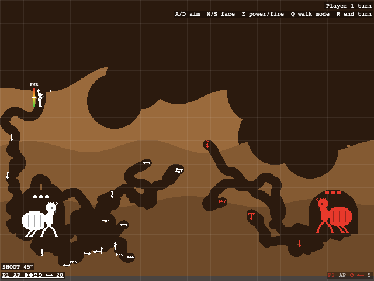

# Termites

A two-player, turn-based artillery and digging game for the browser. Two termite colonies share one keyboard and one dirt-filled screen. Each side has a queen in an underground chamber, one soldier on the surface, and a swarm of drones that wander and tunnel through the dirt on their own. Drones are your economy: every 5 drones is 1 action point (AP) per turn, which your soldier spends to walk and to lob arcing shots that blast craters. Kill the enemy queen to win.

**Play it: https://mitchellhillman.github.io/termites/**



## How to play

- First to kill the enemy Queen wins!

## Run locally

```sh
python3 -m http.server
```

Then open http://localhost:8000.

## Tweak it

- Adjust game settings in **`balance.json`**.
- **`map.png`** (640x480) is the level. Use exactly the colors from `terrainKey` in `balance.json`; any other color loads as open space:

  | Color     | Terrain             | Blast resistance factor |
  | --------- | ------------------- | ----------------------- |
  | `#2b1a0e` | Open (sky, tunnels) | empty                   |
  | `#9a6a3c` | Soft dirt           | 1                       |
  | `#845a32` | Medium dirt         | 0.75                    |
  | `#6e4a29` | Hard dirt           | 0.5                     |
  | `#4a4440` | Bedrock             | undiggable, unblastable |

  Each queen is placed on the first floor found scanning down from `queen.spawnScanY` at her team's `queenX`, so keep a chamber there.

- **Regenerate assets** (Node, no dependencies, run from the repo root):
  - `node tools/generate-map.mjs` rebuilds `map.png` from the `mapGenerator` settings (seeded, so it's repeatable).
  - `node tools/generate-sprites.mjs` rebuilds the white-on-transparent sheets in `sprites/` from the ASCII art in the script. The game tints them to team colors at runtime.

  **Both overwrite their output, so hand edits to `map.png` or the sprite PNGs are lost.**

- **Debug:** set `debug.clickToExplode` to `true` to click (or click-drag) anywhere to blast the terrain. Change the radius with the mouse wheel or `[` / `]`.

## Project layout

```
index.html        page and canvas; loads src/main.js
balance.json      all tuning values, key bindings and the terrain color key
map.png           the level (terrain colors)
sprites/          sprite sheets: drone, soldier, queen, skull, cursor
src/
  main.js         startup, game loop, title / play / win flow
  terrain.js      map loading, destructible terrain, rendering
  units.js        soldiers, queens, drones (movement, digging, death)
  shots.js        aiming, power bar, ballistics, explosions
  turns.js        turn order, AP, drone spawns
  input.js        keyboard bindings and the debug click-to-explode tool
  hud.js          HUD, title and win screens, announcements
  sprites.js      sprite sheet loading and tinting
tools/            map and sprite generators (plus a tiny PNG encoder)
docs/             README screenshot
```

The full design spec is in [plan.md](plan.md).
